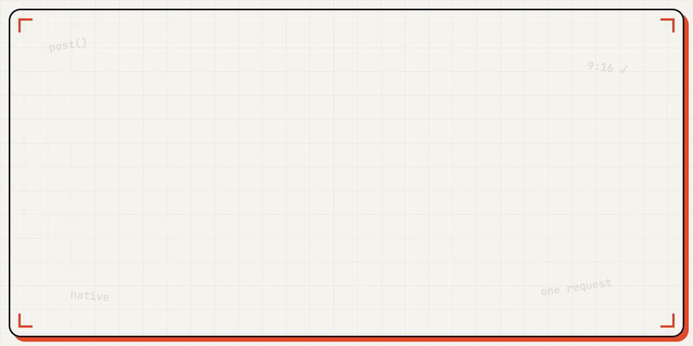
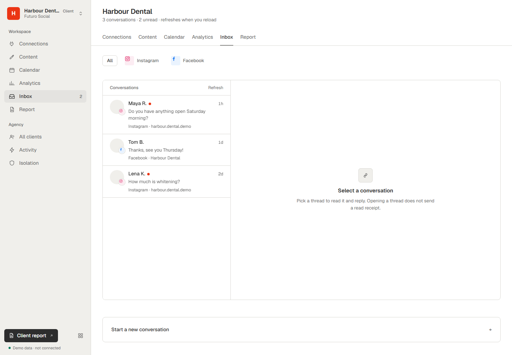

# Zernio Library Skills

<p align="center">
  
</p>

**Claude Code skills and a working app for building social media products on [Zernio](https://zernio.com)'s one API.**
Post everywhere, run the inbox, launch ads, answer WhatsApp with AI, or build your own white-label tool for your clients.

## Start here

| You want to… | Go to |
|---|---|
| **Build your own white-label app**, step by step, with Claude Code | [`white-label-blueprint`](.claude/skills/white-label-blueprint/SKILL.md) (Part 1: your brand, client workspaces, posting), then [`white-label-client-report`](.claude/skills/white-label-client-report/SKILL.md) (Part 2: the branded client report) |
| **Clone the finished app** and make it yours | [`apps/white-label-app/`](apps/white-label-app/) |
| Use a single skill (publish, inbox, ads, automations) | [The skills](#the-skills) |

## The app

[`apps/white-label-app/`](apps/white-label-app/) is the white-label portal built in the videos: your agency's name on every page, one isolated workspace per client, all on one Zernio key.

| Tab | What it does |
|---|---|
| **Connections** | Clients connect their accounts on a page with only your brand (headless OAuth), with account health |
| **Content** | Post now or schedule across platforms; the queue with retry |
| **Calendar** | The month of scheduled and published posts |
| **Analytics** | Per-platform breakdown, latest posts, best time to post |
| **Inbox** | One conversation list across channels, replies, webhooks |
| **Report** | Organic and paid side by side, inbox response time, comment sentiment, a branded client link and a PDF, with a "Show spend" switch |


**Quickstart: see it in a minute, no Zernio account needed**

```bash
git clone https://github.com/Enriquemarq1/zernio-library-skills.git
cd zernio-library-skills/apps/white-label-app
npm ci
npm run demo      # three made-up clients on a local fake API → http://127.0.0.1:3000
npm test          # 45 tests, never the real API
```

Then put in your own key and clients (`.env.example`, `clients.example.json`): [full setup](apps/white-label-app/README.md#run-it-on-your-zernio-account).
**The brand lives in one place:** `BRAND` at the top of [`views.js`](apps/white-label-app/views.js) (name, logo, accent colour). The demo agency is "Futuro Social"; swap in your own.



## The skills

| Skill | What it does |
|---|---|
| [`white-label-blueprint`](.claude/skills/white-label-blueprint/SKILL.md) | Build your own white-label social media tool: OAuth under your brand, a workspace per client, posting, webhooks, then the polish loop to product grade |
| [`white-label-client-report`](.claude/skills/white-label-client-report/SKILL.md) | Add a client report with only your logo: organic and paid, response time, sentiment, client link and PDF |
| [`zernio-inbox-integration`](.claude/skills/zernio-inbox-integration/SKILL.md) | Add Zernio's unified inbox (SMS, WhatsApp, Instagram, Messenger…) to an app you already have |
| [`zernio-publish`](.claude/skills/zernio-publish/SKILL.md) | Publish one asset to 13 platforms with tailored captions, an approval gate and a check that it landed |
| [`clip-machine`](.claude/skills/clip-machine/SKILL.md) | One long video in, native TikTok, Reels and Shorts posts out: cut, caption, cover, post |
| [`zernio-comment-to-dm`](.claude/skills/zernio-comment-to-dm/SKILL.md) | Instagram and Facebook comment-to-DM automations and DM sequences, on command |
| [`meta-ads-launch`](.claude/skills/meta-ads-launch/SKILL.md) | Launch a batch of Meta ads in one call, paused until you review them |
| [`zernio-workflow-creator`](.claude/skills/zernio-workflow-creator/SKILL.md) | Build Zernio conversation workflows, including a 24/7 WhatsApp customer-service agent |
| [`zernio-voice-agent`](.claude/skills/zernio-voice-agent/SKILL.md) | One WhatsApp number as an AI front desk: text replies plus inbound calls to a Retell AI voice agent |
| [`skill-creator`](.claude/skills/skill-creator/SKILL.md) | Anthropic's official skill-creator, bundled for adding your own skills |

New to a skill? `white-label-blueprint` and `clip-machine` each have an initiation prompt you paste into Claude Code in an empty folder ([blueprint](.claude/skills/white-label-blueprint/reference/initiation-prompt.md), [clip machine](.claude/skills/clip-machine/reference/initiation-prompt.md)).

## Videos

- **Part 1:** build a white-label social media app on Zernio: https://youtu.be/0FqJkCTCmMY
- **Part 2:** the white-label client report: _link coming soon_ <!-- TODO: add the Part 2 YouTube link -->

## Install the skills

Claude Code loads any skill at `.claude/skills/<skill-name>/SKILL.md` in your project.

- **Use this repo as your project:** `git clone` it, `cd` in, run `claude`.
- **Add them to your own project:** copy the skill folders into your `.claude/skills/`, next to your own (merge, don't replace):

  ```bash
  cp -r /path/to/zernio-library-skills/.claude/skills/* .claude/skills/
  ```

  ```powershell
  Copy-Item -Recurse \path\to\zernio-library-skills\.claude\skills\* .claude\skills\
  ```

Restart Claude Code and type `/`: the skills show up (for example `/zernio-publish`), and they also trigger when you describe the task ("post this video to TikTok"). If not, check that `.claude/skills/zernio-publish/SKILL.md` exists at exactly that path. For claude.ai, zip a skill folder and upload it under Capabilities → Skills.

**Your key:** put your key from https://zernio.com/dashboard/api-keys in `.env` at the repo root, then run `git update-index --skip-worktree .env` so it never gets committed. (The app has its own `.env`; see its README.)

## Requirements

- [Claude Code](https://claude.com/claude-code) for the skills
- A [Zernio](https://zernio.com) account and API key for anything live (the app's demo and tests need none)
- Node.js 22.13 or newer for the app

## How the skills work

- **The skill informs, the agent acts.** A SKILL.md is knowledge plus a suggested workflow; Claude uses its own tools (bash, curl, ffmpeg, vision, web) to do the work.
- **Approval before publish.** Anything that posts, sends or spends passes through your explicit yes.
- **Verify, don't trust.** A 200 from the API isn't a post on the platform; the skills check that it landed.

## Contributing

Issues and pull requests are welcome. To add a skill, create `.claude/skills/<your-skill>/SKILL.md` with `name` and `description` frontmatter; the bundled `skill-creator` helps you design and test it. For the app, run `npm test` before you open a pull request, and keep real keys, profile ids and account data out of commits.

## Licence

[MIT](LICENSE)
