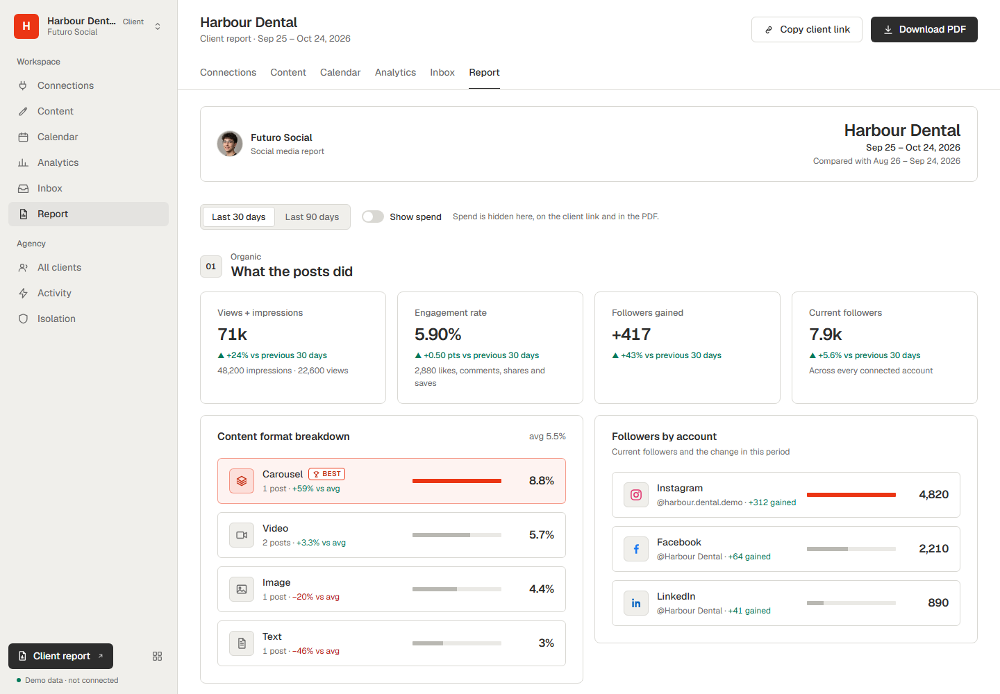

# White-label app

A finished white-label social media portal for agencies, built on [Zernio](https://zernio.com)'s API. Your agency's name and logo on every page; each client gets an isolated workspace, a branded connect link and a report with only your brand on it.

This is the app built in the video series, as it stands at the end of Part 3. Clone it, or read it next to the skills ([`white-label-blueprint`](../../.claude/skills/white-label-blueprint/SKILL.md), then [`white-label-client-report`](../../.claude/skills/white-label-client-report/SKILL.md), then [`white-label-automations`](../../.claude/skills/white-label-automations/SKILL.md)) and paste the stages into your own app.



## What it does

| Tab | What you get |
|---|---|
| **Connections** | Headless OAuth: the client connects their accounts on a page that carries only your brand. Account health per account, "reconnect needed" before the client notices. |
| **Content** | Post now or schedule to several platforms at once; the queue grouped by failed, scheduled, published and drafts, with retry and delete. |
| **Calendar** | The month of scheduled and published posts, per client. |
| **Analytics** | Totals from the platform breakdown, a sortable per-platform table, latest posts and the best times to post. |
| **Inbox** | One conversation list across the client's channels, history, replies with an idempotency key (never sent twice), explicit mark-read, start a thread where the channel allows it, and webhooks for new messages. |
| **Automations** | Your own ManyChat for every client: comment-to-DM with buttons and a public reply, followers-only rewards with Zernio's one-tap confirm, story-mention thank-yous, links and QR codes, repeat rules, and a live activity log. A When → Then builder with an iPhone + Instagram preview. Everything is also a tool for your AI agent (`mcp/automations-mcp.mjs`, `.mcp.json`). How it works: [docs/automations/](docs/automations/README.md). |
| **Report** | Organic from the one-call analytics dashboard, paid next to organic, inbox response time, comment sentiment, a branded client link and a PDF. A "Show spend" switch keeps the budget out of shared links. |

Plus an agency dashboard (all clients, connected accounts, add a client), an activity log and an isolation page that asks Zernio for another client's data with one client's key, so you can see the API refuse it.

Express 5, Node 22.13 or newer, server-rendered HTML, no front-end build, no database for the social data (Zernio is the record). Three dependencies: `express`, `sentiment` and `qrcode`.

## Try it in one minute (no Zernio account)

```bash
cd apps/white-label-app
npm ci
npm run demo
```

Open http://127.0.0.1:3000. Three made-up clients on a local fake of the Zernio API (`tests/fake-zernio.mjs`). Every tab works; nothing leaves your machine. Use `PORT=3100 npm run demo` if 3000 is taken. `npm run demo:automations` opens the Automations tab with sample automations and activity (http://127.0.0.1:3901/w/demo_bakery/automations).

## Run it on your Zernio account

1. **Key.** Create an API key at https://zernio.com/dashboard/api-keys.
2. **Environment.** `cp .env.example .env` and set `ZERNIO_API_KEY`. Change `WEBHOOK_SECRET` and `REPORT_LINK_SECRET` to long random strings.
3. **Clients.** Either start with no `clients.json` and press **Add client** on the dashboard (it creates a Zernio profile and writes `clients.json` for you), or copy the example and fill in profiles you already have:

   ```bash
   cp clients.example.json clients.json
   ```

   ```json
   [
     { "name": "Harbour Dental", "profileId": "your-zernio-profile-id" },
     {
       "name": "Summit Fitness",
       "profileId": "your-zernio-profile-id",
       "keyFile": "./keys/summit-fitness.env",
       "platforms": ["facebook"],
       "adAccountId": "act_your_meta_ad_account_id"
     }
   ]
   ```

   | Field | Required | What it does |
   |---|---|---|
   | `name` | yes | The client's name on every page. |
   | `profileId` | yes | The client's Zernio profile. One profile per client is what keeps workspaces apart. |
   | `keyFile` | no | A file holding a key for this client only (a bare key, or `ZERNIO_API_KEY=...`). Read per request, never shown. If it can't be read, the workspace fails closed: it never falls back to your main key. |
   | `platforms` | no | Show only these platforms for this client, everywhere in the portal. |
   | `adAccountId` | no | Pin the report's paid column to one ad account. Without it, ads are listed by the client's profile (which can read empty while Zernio is still syncing history). `node --env-file=.env scripts/find-ad-account.mjs <keyFile>` lists the ones your key can reach. |

   `clients.json` and `keys/` are in `.gitignore`.
4. **Start.**

   ```bash
   npm ci
   npm run dev        # node --env-file=.env server.js
   ```

   Open http://localhost:3000 and send a client its connect link.
5. **Webhooks (optional, for live inbox events).** Point `WEBHOOK_URL` at a public tunnel to this machine, then `node --env-file=.env setup-webhook.js` (dry run) and `--apply`.

## Make it your agency

The brand lives in one place, `BRAND` at the top of [`views.js`](views.js):

```js
export const BRAND = {
  name: 'Futuro Social',          // your agency's name, on every page, the client link and the PDF
  short: 'Futuro',
  tagline: 'Social media from the future',
  face: '/agency-face.jpg',        // your logo or your face, in public/
  accent: '#EB3514',               // your one accent colour
  favicon: '/agency-face.jpg',
};
```

Put your logo in `public/`, point `face` and `favicon` at it, and set `accent`. For the full colour system, the design tokens are at the top of `public/app.css`; the design system behind them is in the skill's [design-system.md](../../.claude/skills/white-label-client-report/reference/design-system.md).

## How the report works

One page, two doors: `/w/:profileId/report` is the agency's tab; `/c/:profileId/report` is the client's link with your brand and none of your navigation. A 30 or 90 day window drives every section, with the previous period beside it. The PDF is the browser's print to PDF with a print stylesheet.

| Section | Zernio endpoint (all GET) |
|---|---|
| Organic | `/analytics/dashboard?profileId&fromDate&toDate&compare=previous_period&topPosts=5`, plus `/analytics` (posts with their numbers, for the content format breakdown) and `/analytics/daily-metrics` (platform breakdown) |
| Paid | `/ads?adAccountId&source=all&fromDate&toDate` (or by `profileId` when no ad account is pinned). A `202` with `backfillPending` shows "syncing", never a zero |
| Response time | `/analytics/inbox/response-time` and `/analytics/inbox/volume` |
| Sentiment | `/inbox/comments?profileId&minComments=1`, then `/inbox/comments/{postId}`, scored by `report/sentiment.js` (the `sentiment` word list, offline) |

Spend, CPC, cost per result, CPM and ROAS are hidden until "Show spend" is on. On the client link they show only when the link carries a signature made with `REPORT_LINK_SECRET`, so editing the URL can't reveal them.

## Honest limits

- **No login.** The portal binds to `127.0.0.1` by default. Add authentication and per-user tenant checks before you put it on a network.
- **Live reads.** Every number is read from Zernio when the page opens. For many clients in production, Zernio's [multi-tenant analytics guide](https://docs.zernio.com/multi-tenant/analytics.mdx) recommends a sync worker that fills your database hourly.
- **Data freshness.** Follower counts refresh once a day; post metrics are cached for an hour; YouTube daily views arrive two to three days late; Instagram insights run about a day behind. The report shows its "as of" time.
- **Different platforms, different numbers.** Some report views, others impressions; TikTok has no reach. The app shows what each platform gives instead of inventing a common number.
- **Response time** covers conversations that got an answer; the reply share comes from the volume endpoint.
- **Sentiment is this app's estimate, not Zernio's.** A word-list scorer: free, offline, rough. Swap in a language model for nuance. The report shows counts and themes, never who said what.
- **Automations.** Instagram can refuse buttons in the first DM to someone who doesn't follow the account (the "ask first" template opens with plain text). A link or QR code with a `ref` only fires when Instagram passes the ref along, which it doesn't always do; the dependable version is a QR card that says "send MENU" and a keyword automation that answers. Every DM counts as a Zernio outbound message (first 10,000 a month free, then $1 per 10,000).
- **Inbox.** Instagram and Facebook can't start a thread (the person has to message first); WhatsApp needs an approved template after 24 hours. Details and the docs audit are in [docs/zernio-inbox/](docs/zernio-inbox/CAPABILITIES.md).

## Tests

```bash
npm test
```

61 tests against `tests/fake-zernio.mjs` and `tests/fake-automations.mjs`, local fixtures of the Zernio API. They never call the real API; they check that building every report makes GET requests only, that every automation recipe sends what Zernio documents, that one client can never see or change another's automations, and that the MCP server exposes the same actions.

## Files

```
server.js            the agency dashboard, workspace tabs, posting, connect flow, webhooks
views.js             BRAND, the shell and shared UI pieces
zernio.js            the thin Zernio API wrapper (the key never leaves the server)
workspace.js         per-request client context: its key file, platform list and ad account
report/              the client report: data, views, routes, sentiment
inbox/               the unified inbox: adapter, routes, tenancy checks, webhooks, local store
automations/         the Automations tab and its JSON API: recipes, workspace checks, views, routes
mcp/                 the MCP server that gives an AI agent the Automations tools
public/              app.css and the agency mark
scripts/demo.mjs     demo mode on made-up data
scripts/demo-automations.mjs  the Automations tab on sample data
scripts/*-probe.mjs  read-only checks against your own account (GET only)
setup-webhook.js     registers the webhook (dry run by default)
tests/               the fixture API and the test suites
```

MIT, like the rest of the repo.
