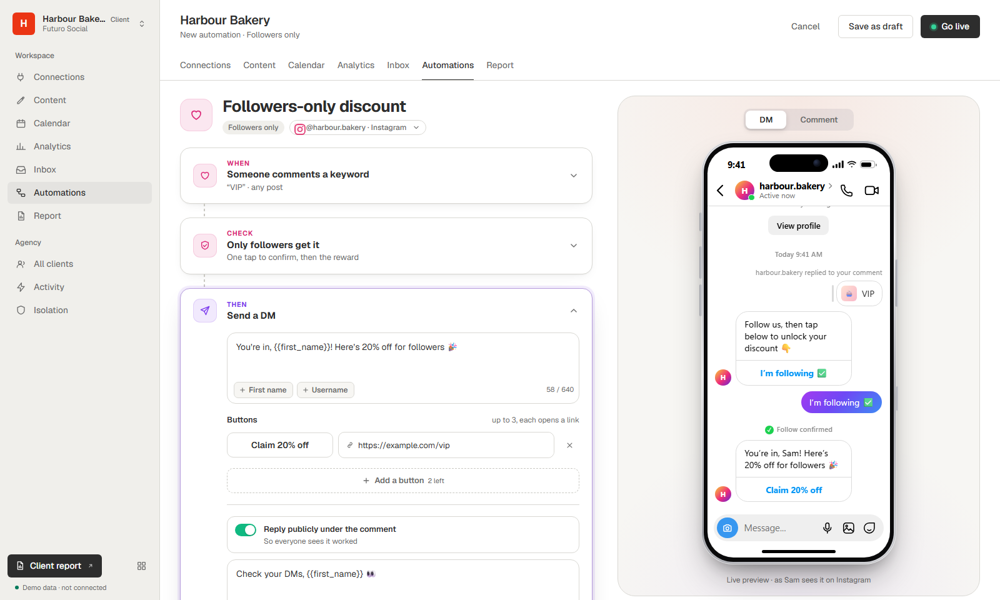

# The Automations tab

ManyChat-style automations for every client workspace, running on Zernio. Part 3 of the white-label app videos (October 2026).



## What it does

Five templates, each a short When → Then form with a live phone preview:

| Template | What happens | On Zernio |
|---|---|---|
| Comment → DM | Someone comments a keyword (on any post or one post), they get a DM with up to 3 link buttons, plus an optional public reply. Can also fire when they DM the keyword. | comment automation, `trigger: comment` |
| Followers only | Same, but only followers get the reward. Anyone Instagram doesn't know yet gets a one-tap "I'm following" check; the tap counts as a message, Zernio checks the follow and sends the reward. | comment automation + `audience { followerStatus: follower, whenUnknown: verify }` + `followGate` |
| Story mention → DM | Someone mentions the account in their story, they get a DM. Instagram only. | comment automation, `trigger: story_mention` |
| Link or QR → flow | An `ig.me/m/<username>?ref=<name>` link (or its QR code) opens the DMs and starts a flow: a DM with buttons, then a tag on the contact. | workflow, `triggerType: referral` |
| Comment → ask first | For people who don't follow yet: a plain first DM, then the button once they reply. | workflow, `triggerType: comment` → `wait_for_reply` |

Every automation has a repeat rule (once per person, or every time with an optional wait), a live/paused switch, and a page with its numbers and a live activity table read from Zernio every 4 seconds.

## Where the code is

- `automations/recipes.js`: the five recipes, turned into exactly what Zernio's API takes, and read back from it.
- `automations/service.js`: the workspace rule (an automation belongs to a workspace only when Zernio's account list for that profile has its account) and every operation.
- `automations/routes.js`: the tab's pages and the JSON API.
- `automations/views.js`: the screens.
- `mcp/automations-mcp.mjs`: the MCP server for AI agents.
- `tests/automations.test.mjs` with `tests/fake-automations.mjs`: 16 tests on fixtures, never the real API.
- `scripts/demo-automations.mjs`: the tab on fixture data (`npm run demo:automations`).

## For an AI agent

Claude Code opened in this folder picks up `.mcp.json`, so the tools are there with the portal running (`npm run dev`). Other clients: run `node mcp/automations-mcp.mjs` with `PORTAL_URL`.

Tools: `list_workspaces`, `get_recipes`, `list_automations`, `list_posts`, `get_automation`, `create_automation`, `update_automation`, `set_automation_live`, `delete_automation`, `get_activity`.

The JSON API behind them (local only; set `PORTAL_AGENT_TOKEN` to require `Authorization: Bearer <token>`; cross-site browser requests are refused):

```
GET    /api/workspaces
GET    /api/recipes
GET    /api/w/:profileId/automations
GET    /api/w/:profileId/posts?accountId=
POST   /api/w/:profileId/automations                     { recipe, name, accountId, ... }
GET    /api/w/:profileId/automations/:kind/:id           kind = comment | flow
PATCH  /api/w/:profileId/automations/:kind/:id           only the fields to change
POST   /api/w/:profileId/automations/:kind/:id/activate | /pause
DELETE /api/w/:profileId/automations/:kind/:id
GET    /api/w/:profileId/automations/:kind/:id/activity  handles and outcomes, never what people wrote
```

## Limits worth knowing (Zernio's docs, October 24, 2026)

- Instagram can refuse buttons in the first DM to someone who doesn't follow the account. "Comment → ask first" opens with plain text for them.
- Liking the comment works on Instagram only for accounts connected through Facebook Login; otherwise the log says it was skipped.
- One active per-post automation per post (Zernio answers 409). Account-wide ones stack.
- When a comment automation and a comment workflow both match, the automation answers.
- Every DM counts as an outbound message: the first 10,000 a month are free, then $1 per 10,000 (metered since October 1, 2026).
- Comments arrive by webhook; Zernio also re-reads the latest comments every 10 minutes and answers any the webhook missed.

## Try it without an account

`npm run demo:automations` starts the tab on fixture data (no Zernio key): http://127.0.0.1:3901/w/demo_bakery/automations.
